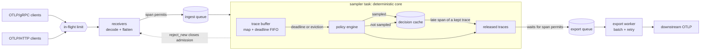

# tailsample

[](https://github.com/SlateGitOrg/tailsample/actions/workflows/ci.yml)

A tail-based trace sampler written in Rust. It receives spans over OTLP/gRPC
and OTLP/HTTP, groups them into traces in a bounded in-memory buffer, waits
for each trace to finish arriving, decides with an ordered set of policies
(latency, error status, attribute match, probabilistic, rate limit, and
composite with per-policy span budgets), and exports the traces it keeps to
any OTLP endpoint. Spans that turn up after their trace was decided are
routed through a decision cache. Memory is capped by explicit trace and byte
limits with a configurable eviction policy, and when a downstream is slow
the receivers refuse data with retryable OTLP errors instead of buffering
without limit.

## Why

Head-based sampling decides before a trace exists, so it cannot keep "every
error" or "every slow request". Tail sampling decides after the trace has
arrived, at the price of buffering. tailsample keeps that machinery in one
small codebase so its behavior under load is easy to inspect: what gets
dropped when memory runs out, how budgets cap an error storm, and where
backpressure shows up. It is not a drop-in replacement for the
OpenTelemetry Collector's `tail_sampling` processor (see
[Limitations](#limitations)).

## Features

| | |
|---|---|
| Receivers | OTLP/gRPC `TraceService/Export` (gzip ok); OTLP/HTTP `POST /v1/traces` with protobuf or JSON, identity or gzip; `partial_success` for spans with invalid trace ids; `/metrics` (Prometheus text) and `/healthz` |
| Trace assembly | `HashMap` of traces plus one FIFO of deadlines; decision wait counted from a trace's first span; per-trace span cap |
| Memory bound | `max_traces` and `max_bytes` (estimated span bytes), eviction `decide_early` / `drop_oldest` / `reject_new` |
| Policies | `always_sample`, `latency`, `status_code`, `span_count`, `attribute` (exact / regex / numeric range / invert), `probabilistic`, `rate_limiting` (token bucket), `and`, `composite` (per-sub-policy span budgets per second) |
| Late spans | two FIFO-bounded decision caches (sampled / not sampled) |
| Exporter | batching OTLP/gRPC or OTLP/HTTP exporter with bounded exponential-backoff retries |
| Backpressure | bounded ingest and export queues measured in spans; 429/503 + `Retry-After` over HTTP, `UNAVAILABLE` + `retry-after` over gRPC |
| Tooling | load generator (span trees over a 9-service e-commerce topology with injected slow, error and late traces), offline simulator, debug sink, loopback demo, benchmark and evaluation harnesses |

## Architecture



The sampling core (`Sampler`) is a synchronous state machine driven by a
logical millisecond clock: it never touches a socket, a lock or the wall
clock. One tokio task owns it; receivers and the exporter talk to it through
bounded channels. Because the core is deterministic, the budget tests, the
evaluation and the core benchmark run the exact production code on simulated
time. [docs/ARCHITECTURE.md](docs/ARCHITECTURE.md) covers the span lifecycle,
data structures and complexity, the memory formula, backpressure and
shutdown in detail.

| Module | Role |
|---|---|
| `config` | TOML schema, defaults, validation |
| `ids`, `model` | trace ids, flattening OTLP into `SpanRecord`s with shared resource/scope, regrouping for export, byte estimates |
| `buffer`, `cache` | bounded trace buffer; decision cache |
| `policy` | `Policy` trait, the nine kinds, ordered `PolicyEngine` |
| `sampler` | admission, eviction, decisions, span accounting |
| `runtime`, `server` | sampler task, bounded queues, listeners, graceful shutdown |
| `receiver::{grpc,http}`, `exporter` | OTLP in and out |
| `telemetry` | counters and a Prometheus renderer |
| `loadgen`, `sim`, `sink`, `demo` | traffic generation, offline simulation, debug sink, loopback demo |

## Quick start

Requires a Rust toolchain (1.85+). `make check` also needs
[`cargo-llvm-cov`](https://github.com/taiki-e/cargo-llvm-cov).

```sh
make check      # fmt check, clippy -D warnings, all tests, line coverage >= 80%
make demo       # offline loopback demo (sink + sampler + load generator)
make eval       # policy evaluation on held-out seeds
make bench      # throughput and memory benchmark + evaluation, written to bench/
```

Run the sampler in front of a collector:

```sh
cargo build --release
./target/release/tailsample check-config -c examples/sampler.toml
./target/release/tailsample sink --listen 127.0.0.1:14317 &          # or a real collector
./target/release/tailsample serve -c examples/sampler.toml           # :4317 gRPC, :4318 HTTP
./target/release/tailsample loadgen --grpc http://127.0.0.1:4317 --traces 5000 --rate 500
curl -s 127.0.0.1:4318/metrics | grep tailsample_traces_total
```

Try a policy file against generated traffic without any sockets:

```sh
./target/release/tailsample simulate -c examples/sampler.toml --traces 5000
```

The log filter is the only environment variable (`RUST_LOG`, see
`.env.example`).

## Configuration

`examples/sampler.toml` is the reference configuration (keep every error
trace, keep slow traces, keep a budgeted 5% of the rest, never keep health
checks):

```toml
[buffer]
decision_wait_ms = 5000
max_traces = 50000
max_bytes = 134217728          # 128 MiB of estimated span data
eviction = "decide_early"      # or "drop_oldest", "reject_new"

[backpressure]
max_queued_spans = 100000
mode = "reject"                # or "block" (waits up to block_timeout_ms)

[[policies]]
name = "budget"
type = "composite"
max_total_spans_per_second = 3000
rate_allocation = [
  { policy = "errors", percent = 60 },
  { policy = "slow", percent = 25 },
]

  [[policies.sub_policies]]
  name = "errors"
  type = "status_code"
  codes = ["ERROR"]

  [[policies.sub_policies]]
  name = "slow"
  type = "latency"
  threshold_ms = 1000

  [[policies.sub_policies]]
  name = "baseline"            # gets the unallocated 15%
  type = "and"
  sub_policies = [
    { name = "five-percent", type = "probabilistic", percentage = 5.0 },
    { name = "not-health", type = "attribute", key = "http.route", values = ["/healthz"], invert = true },
  ]
```

Top-level policies are evaluated in order and the first that samples wins.
Inside a composite, a sub-policy that wants a trace but has used its budget
for the current one-second window passes the trace on to the next one.

## Demo

`make demo` starts a recording OTLP/gRPC sink and a sampler on ephemeral
loopback ports, sends 3,000 generated traces at 600 traces/s, half over
gRPC and half over HTTP, plus one hand-written OTLP/JSON error trace
(`fixtures/checkout-error.json`), scrapes `/metrics`, shuts down cleanly and
scores what arrived at the sink against the generator's ground truth.
Output of a real run:

```
tailsample demo: sink + sampler on loopback, 3000 traces at 600/s

load: 12879 requests (6440 via OTLP/gRPC, 6439 via OTLP/HTTP), 36472 spans accepted, 0 backpressure retries, 0 failed

class      traces     kept    kept%  complete   spans_in  spans_out
error          44       44  100.00%        44        555        555
slow           63       63  100.00%        63        879        879
normal       2893      134    4.63%       134      35038       1821

fixture trace 4bf92f3577b34da6a3ce929d0e0e4736 (OTLP/JSON, status ERROR) kept: true
sampler: 36474 spans received, 3253 sampled, 33191 not sampled, 4 late forwarded, 26 late dropped
exporter -> sink: 3257 spans in 54 requests
metrics scraped from /metrics before shutdown:
  tailsample_traces_total{outcome="received"} 3001
  tailsample_traces_total{outcome="sampled"} 242
  tailsample_traces_total{outcome="not_sampled"} 2759
  tailsample_traces_total{outcome="decided_early"} 0
  tailsample_traces_total{outcome="evicted"} 0
  tailsample_sampled_traces_by_policy_total{policy="budget/baseline"} 134
  tailsample_sampled_traces_by_policy_total{policy="budget/errors"} 45
  tailsample_sampled_traces_by_policy_total{policy="budget/slow"} 63
demo wall time: 12.7s
```

The metrics scrape happens before shutdown, so it does not yet include the
traces still inside their decision wait; the table above it is computed
after the shutdown flush. "complete" means every span of the trace reached
the sink.

## Evaluation

`make eval` (source: `examples/eval.rs`; full output in
`bench/eval-results.md`). All traffic is synthetic, from seeds 5001+ that no
test uses; the reference policy was written before the evaluation ran.

**Reference policy at nominal load** (30,000 traces at 500/s, 2% errors, 2%
latency spikes, 1% of traces with a span 6-9 s late):

| seed | error traces kept | complete | slow kept | other kept | span reduction | peak error spans/s (budget 1800) |
|---:|---:|---:|---:|---:|---:|---:|
| 5001 | 540/540 | 100.0% | 100.0% | 4.6% | 91.4% | 259 |
| 5002 | 598/598 | 100.0% | 100.0% | 4.6% | 91.2% | 249 |
| 5003 | 600/600 | 100.0% | 100.0% | 4.7% | 90.9% | 259 |

**Error storm: the budget is a cap.** Once errors need more than their
1,800 spans/s, the error sub-policy stops at its budget instead of flooding
the downstream:

| error rate | error traces | kept | peak error spans/s |
|---:|---:|---:|---:|
| 5% | 911 | 100.0% | 419 |
| 20% | 3750 | 100.0% | 1626 |
| 40% | 7251 | 77.4% | 1800 |
| 80% | 14663 | 41.8% | 1800 |

**Eviction under memory pressure** (`max_bytes` = 4 MiB, about a third of a
second of traffic against a 5 s wait):

| eviction | error traces kept | slow kept | spans refused |
|---|---:|---:|---:|
| `decide_early` | 97.5% | 19.5% | 0 |
| `drop_oldest` | 3.0% | 9.1% | 0 |
| `reject_new` | 19.8% | 8.2% | 129151 |

`decide_early` keeps errors because error spans are usually already in the
buffer when a trace is evicted; latency decisions suffer because the slow
span often has not arrived yet. The evaluation also sweeps the decision wait
(1-10 s) against slow-trace recall and late-span handling.

## Benchmarks

`make bench` (source: `src/bin/tailsample-bench.rs`; results with machine
details in `bench/bench-results.md`). Measured on an Apple M1 Pro (8 cores)
shared with other build jobs, so absolute numbers are noisy.

| What | Result |
|---|---|
| Core sampler, single thread, simulated clock, reference policies | median **1.73M spans/s** over 3 runs (1.28M-1.74M), about 577 ns/span |
| End-to-end OTLP/gRPC over loopback, 8 clients, null exporter | **320k spans/s** accepted |
| Same, exporter capped at ~51k spans/s, every trace sampled | 39k spans/s accepted, 6,992 requests refused (and retried) |
| Real heap per configured byte of buffer, generator workload (`decide_early`, 8-128 MiB) | **1.16-1.21x** `max_bytes` |
| Same, one span per request with its own 4 KiB resource (1-8 MiB) | buffer heap **1.16-1.17x** `max_bytes` |

The memory benchmark streams 60,000 traces at 4,000/s with a 5 s wait (an
unbounded buffer would need about 240k spans) through a counting global
allocator. Real heap attributable to the sampler stays at about 1.2x
`max_bytes` for every limit and eviction policy tried, because the byte
estimate leaves out container slack: size `max_bytes` at about 80% of the
memory you want the buffer to use.

The estimate covers every span's own allocations plus each distinct
resource/scope context the buffered spans keep alive, charged once while any
buffered span references it. That matters when clients send one span per
request (an SDK with a simple/per-span processor) with large resource
attributes: there the context is most of the memory. The second memory table
streams 20,000 such requests, each with a 4 KiB resource attribute; the
buffer holds 215 spans in 1 MiB (93% of the estimate is resource context) and
its real heap stays at 1.17x `max_bytes`. Before this was charged, a 1 MiB
buffer held all 3,000 spans of the same pattern, about 12 MiB of resource
data (`tests/memory.rs` keeps that from coming back). The decision cache is
a separate term: in that run it reached about 20k entries, roughly 70 bytes
each. The end-to-end peak heap figures (314 MiB null exporter, 105 MiB capped)
include the in-process load clients and a 256 MiB buffer limit; see the
results file.

## Tests and coverage

```sh
make test       # 95 tests: unit, property, simulation and loopback end-to-end
make coverage   # cargo llvm-cov, fails under 80% line coverage
```

Last measured with `make coverage`: **96.9% line coverage** of the library
(`src/main.rs`, `src/bin/` and `examples/` are excluded; they are exercised
by `make demo` and `make bench`).

The tests that matter most for the spec:

- `tests/budgets.rs`: every injected error trace is kept while errors stay
  within the composite budget; under an error storm the error sub-policy
  never exceeds its budget in any one-second window; `decide_early` keeps
  errors under memory pressure where `drop_oldest` loses them; the rate
  limiter's cap; runs are deterministic.
- `tests/properties.rs` (proptest, 256 cases each): for random interleavings
  of ingest and ticks under every eviction policy, trace and byte limits are
  never exceeded and every span lands in exactly one outcome counter.
- `tests/e2e.rs`: gRPC, HTTP protobuf+gzip, HTTP JSON, 400/413/415, partial
  success, 429/503 with `Retry-After`, gRPC `UNAVAILABLE`, flush on shutdown,
  sampler-to-sampler over OTLP/HTTP.

## Backpressure

Every stage has a bounded queue and nothing in the middle drops data
because a later stage is slow. The sampler *awaits* export capacity; while
it waits it stops draining the ingest queue; when the ingest queue is full
the receivers refuse requests with a retryable error.

| Condition | gRPC | HTTP |
|---|---|---|
| ingest queue full (messages or span permits) | `UNAVAILABLE` + `retry-after` | 429 + `Retry-After` |
| admission closed (`reject_new`, buffer full) | `UNAVAILABLE` | 503 + `Retry-After` |
| shutting down | `UNAVAILABLE` | 503 |
| too many requests decoding at once | waits for a slot | waits for a slot |

In `block` mode a request waits up to `block_timeout_ms` for queue space
before it is refused. A downstream that hangs stalls ingestion for at most
`max_attempts x timeout_ms` (plus backoff) per batch, after which the batch
is dropped and counted in `tailsample_exporter_spans_dropped_total`. Clients
that do not retry lose refused data; that is the OTLP contract, and the
refusal is always explicit.

## Design decisions

The full list, with the cost of each if it is wrong, is in
[DECISIONS.md](DECISIONS.md). The main ones:

- **Deterministic core, async shell.** One task owns the sampler; no locks
  on the hot path; tests and evaluations run production code on simulated
  time. The cost: one process is capped at single-core throughput.
- **One FIFO for expiry and eviction.** The decision wait starts at a
  trace's first span and is the same for every trace, so arrival order is
  deadline order and both "next to expire" and "oldest" are the front, O(1).
- **First matching policy wins.** Later policies' budgets are only spent on
  traces nobody earlier wanted, which makes budgets predictable. The
  Collector evaluates all policies, so ported configs may attribute
  decisions differently.
- **Budgets are per fixed one-second window.** Easy to reason about and to
  test as a hard cap; a sliding second can see up to twice a share across a
  window boundary.
- **Official `opentelemetry-proto` types** for the wire format and the
  OTLP/JSON mapping.

## Limitations

- **Single node.** There is no trace-id-aware load balancing; spans of one
  trace must all reach the same instance, and one instance is bounded by
  one core for sampling decisions.
- **Interop is untested against real SDKs and collectors.** The wire types
  come from the official proto crate and the tests exercise them over real
  sockets, but no test sends from an OpenTelemetry SDK or to a real
  Collector.
- **No TLS and no authentication** on receivers or the exporter (plaintext
  `http://` only). Put it behind a TLS-terminating proxy on a trusted
  network.
- **Memory bound is an estimate.** `max_bytes` bounds estimated bytes of
  buffered spans plus the distinct resource/scope contexts they reference;
  real heap was about 1.2x on both benchmark workloads (batched generator
  traffic, and one span per request with a 4 KiB resource) and will differ
  for other span shapes. Identical resources sent in separate requests are
  charged (and stored) once per request; they are not deduplicated. Queues and in-flight decoding add to it (formula in
  `docs/ARCHITECTURE.md`). One request larger than `max_queued_spans` can
  briefly exceed the queue bound.
- **Decision wait starts at the first span**, not at root-span end, so
  traces longer than the wait are decided incomplete (quantified in the
  evaluation's decision-wait sweep).
- **Probabilistic sampling is not OTEP-235 consistent probability**
  (`th` in tracestate); it does not compose with upstream head sampling.
- **Late spans** of a kept trace are exported on their own; a trace whose id
  has been forgotten by the decision cache starts again as a new, partial
  trace.
- **Synthetic data only.** All evaluation and benchmark traffic comes from
  the bundled generator; real fan-out and payload sizes differ.
- **Config is TOML**, not the Collector's YAML; files are not copy-paste
  compatible. Composite nesting is limited to depth 2.

## Roadmap

- Trace-id-aware load-balancing exporter for running several instances.
- OTEP-235 consistent probability sampling and `tracestate` propagation.
- Interop tests against the OpenTelemetry Collector and an SDK in a
  Docker-based `make integration` target.
- TLS (rustls) and bearer-token auth for receivers and exporter.
- Optional root-span-aware decision wait using a timer wheel.

## License

MIT — see [LICENSE](LICENSE).
