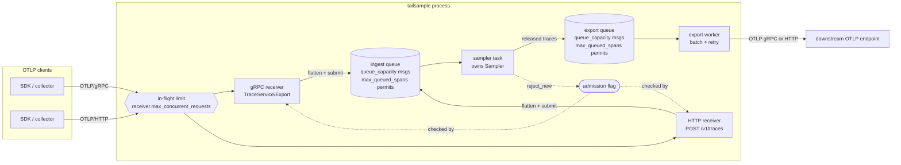
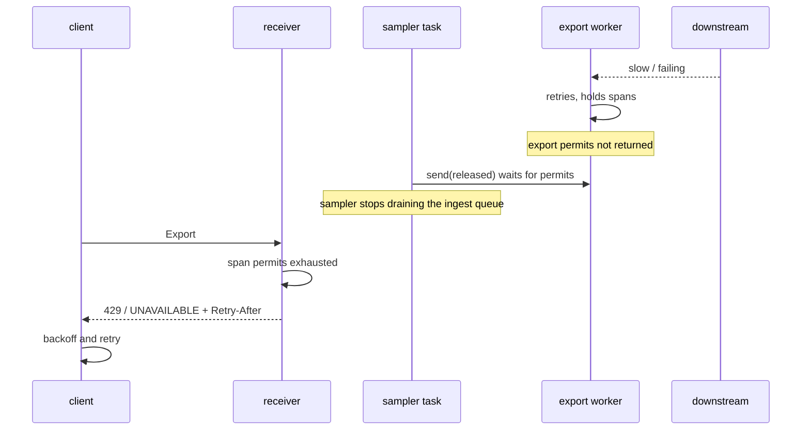

# Architecture

This document describes how tailsample is put together, the algorithms in
the sampling core, their complexity, and how the process behaves when it is
overloaded. Configuration keys are written as `section.key`.

## 1. Components



| Module | Responsibility |
|---|---|
| `config` | TOML schema, defaults, semantic validation |
| `ids`, `model` | `TraceId`; flattening OTLP requests into `SpanRecord`s that share resource/scope context via `Arc`; regrouping for export; per-span byte estimate |
| `buffer` | `TraceBuffer`: traces keyed by id, FIFO of deadlines, byte/trace accounting |
| `cache` | `DecisionCache`: bounded memory of recent decisions for late spans |
| `policy` | `Policy` trait and the nine policy kinds; `PolicyEngine` (ordered, first match wins) |
| `sampler` | `Sampler`: the deterministic core — admission, eviction, decisions, counters |
| `runtime` | `Pipeline`: sampler task, bounded queues, `IngestHandle` used by receivers |
| `receiver::{grpc,http}` | OTLP receivers, error mapping, `/metrics`, `/healthz` |
| `exporter` | `ExportWorker` (batching, retries, permit release), gRPC/HTTP/null exporters |
| `telemetry` | lock-free counters + core snapshot rendered as Prometheus text |
| `server` | binds listeners, wires everything, graceful shutdown |
| `loadgen` | topology, span-tree generator, delivery `Schedule`, live sender |
| `sim` | drives `Sampler` with a `Schedule` on a logical clock and scores against ground truth |
| `sink`, `demo` | a recording OTLP/gRPC endpoint and the loopback demo |

The split that matters is **core vs shell**. `Sampler` never sees a socket,
a lock or the wall clock: it takes spans and a `now_ms` and returns released
traces. Everything asynchronous lives around it. That is why the budget
tests, the evaluation and the core benchmark can drive the exact production
code with simulated time and get bit-identical results.

## 2. Lifecycle of a span

1. **Receive.** A request passes the in-flight limit (a semaphore shared by
   both receivers, acquired before the body is read), is decoded (protobuf
   or JSON, optionally gzip, capped at `receiver.max_request_bytes` after
   decompression) and flattened on the receiver's task. Spans with a trace id
   that is not 16 non-zero bytes are dropped and reported back through
   OTLP `partial_success`.
2. **Admit.** If the admission flag is closed (`reject_new` and buffer full)
   the request is refused. Otherwise it takes `min(spans, max_queued_spans)`
   permits and a channel slot; failing that it is refused (`reject` mode) or
   waits up to `block_timeout_ms` (`block` mode).
3. **Buffer.** The sampler task takes the message, releases the permits once
   processed, and for each span:
   - trace buffered → append (unless the trace has `max_spans_per_trace`
     spans; then the span is counted as `dropped_trace_limit`);
   - trace recently decided → follow the cached decision (forward as a
     *late* span, or drop);
   - otherwise → create a new trace entry whose deadline is
     `now + decision_wait_ms`.
   Before storing, `make_room` enforces `max_traces` and `max_bytes` with the
   eviction policy (section 4).
4. **Decide.** After every message and on every `tick_interval_ms`, traces
   whose deadline has passed are popped from the FIFO and evaluated by the
   policy engine. Sampled traces are recorded in the cache and released;
   others are recorded as not sampled and their memory is freed.
5. **Export.** Released traces take permits on the export semaphore (the
   sampler *waits* here) and go to the export worker, which accumulates up to
   `max_batch_spans` (or `flush_interval_ms`), regroups spans by their
   original resource/scope and sends with up to `max_attempts` tries and
   exponential backoff (doubling from `initial_backoff_ms`, capped at 5 s).
   Permits are returned as spans leave the worker.

Every span ends in exactly one counter bucket; `Sampler::accounted_spans()`
equals `spans_received` at all times, which the property tests assert after
every operation.

## 3. Data structures and complexity

Let *n* be buffered traces, *s* the spans of the trace being decided, *p*
the number of policies (including sub-policies), *C* the decision-cache
capacity.

| Operation | Structure | Time | Notes |
|---|---|---|---|
| append span to buffered trace | `HashMap<TraceId, TraceEntry>` | O(1) expected | aggregates (min start, max end, error count) updated incrementally |
| create trace | map insert + `VecDeque::push_back` | O(1) amortised | deadline = now + wait, so FIFO is sorted by deadline |
| next expired trace | FIFO front | O(1) | `pop_expired` checks only the front |
| evict oldest | FIFO front | O(1) + decision cost | same structure as expiry |
| decide | policies in order | O(p · s) worst case | latency/status/span-count read O(1) aggregates; attribute and generic status scan spans |
| cache lookup / insert | `HashSet` + FIFO `VecDeque` per outcome | O(1) | eviction is FIFO, no reordering on hit |
| regroup for export | `HashMap` keyed by `Arc` pointer | O(spans) | resource/scope identity, not value, comparison |

Memory: buffer O(spans held) bounded by `max_bytes`; FIFO O(n) bounded by
`max_traces`; cache O(C); queues bounded by their span permits.

### Why one FIFO is enough

The decision wait is the same for every trace and the deadline is set when
the first span arrives, so traces enter the FIFO in deadline order. The
oldest trace (eviction victim) and the next trace to expire are therefore
the same element — the front — and both operations are O(1). Traces are only
ever removed from the front, so the map and the FIFO never disagree. A
per-trace wait (e.g. "decide when the root span ends") would break this and
need a min-heap (O(log n)) or a hashed timer wheel.

## 4. Memory bound and eviction

The buffer holds at most `max_traces` traces and `max_bytes` of *estimated*
data. The estimate has two parts:

- **Per span** (`model::estimate_span_bytes`): the size of the `SpanRecord`
  plus the capacity of every owned allocation reachable from the span (ids,
  name, attributes, events, links, nested values).
- **Per distinct shared context** (`model::estimate_resource_bytes`,
  `estimate_scope_bytes`): spans keep the `Arc`'d resource and scope of the
  request they arrived in alive. The buffer reference-counts each scope
  context by `Arc` address (one reference per buffered span) and each
  resource context (one reference per charged scope), charges a context's
  estimate when its first referencing span is stored and releases it when
  the last one leaves. `TraceBuffer::record_cost` gives the incremental cost
  of storing a span (its own bytes plus any context not yet charged), which
  is what the oversize check and `make_room` use; it is recomputed after each
  eviction, since evicting a trace can release the context the new span
  shares. A charged context is kept alive by the span holding the
  reference, so its address cannot be reused while it is a map key.

Without the second part, one-span-per-request traffic with a 4 KiB resource
let a 1 MiB buffer retain about 12 MiB of resource data. Container slack is
still not attributed. The benchmark's counting allocator measures real
buffer heap at about **1.2x** the estimate on both the batched generator
workload and the one-span-per-request workload (`bench/bench-results.md`),
so size `max_bytes` at roughly 80% of the memory you want the buffer to use.

When admitting a span would exceed a limit:

| `buffer.eviction` | Action | Keeps | Loses |
|---|---|---|---|
| `decide_early` (default) | pop the oldest trace(s) and run the policies on them now | errors whose error span has already arrived | latency decisions (slow spans may not have arrived), completeness of decided traces |
| `drop_oldest` | pop the oldest trace(s) and drop them undecided; cache them as not sampled | the newest traces | everything evicted, including errors |
| `reject_new` | refuse the span, close admission until usage < `admission_resume_ratio` of both limits | everything already buffered | new traffic while closed (clients see 503 and retry) |

If the trace receiving a span is itself evicted while making room, the span
follows that trace's fate through the cache path, so a trace is never split
into a decided half and a buffered half.

### Whole-process bound

Roughly, peak heap is

```
  1.2 x buffer.max_bytes
+ (backpressure.max_queued_spans + exporter.max_queued_spans + exporter.max_batch_spans) x avg span size
+ receiver.max_concurrent_requests x max_request_bytes x decode expansion
+ (decision_cache.sampled_capacity + not_sampled_capacity) x ~70 bytes
```

The decode term is a worst case (every in-flight request at the size limit);
protobuf decodes into Rust structs a few times larger than the wire size.
The benchmark's span sizes are about 700-800 bytes per span in memory.

## 5. Backpressure



The chain is deliberate: nothing in the middle drops data because a later
stage is slow. Each stage has a bounded queue, the sampler *awaits* export
capacity, and the refusal surfaces at the receiver as a retryable OTLP
error. The benchmark's capped-exporter scenario shows the effect
(`make bench`, `bench/bench-results.md`): with every trace sampled and an
exporter that sleeps 20 ms per request of at most 1,024 spans (a ceiling of
about 51k spans/s), accepted throughput drops from about 320k spans/s (null
exporter) to about 39k spans/s, roughly 7.0k requests are refused and
retried by the clients, and peak heap stays at 105 MiB instead of growing.
Exported spans/s over the 10 s window (33k) is below the accepted rate
because the first second is spent filling the decision wait.

| Condition | gRPC | HTTP | Counter |
|---|---|---|---|
| ingest queue full (messages or span permits) | `UNAVAILABLE`, `retry-after` metadata | 429 + `Retry-After` | `tailsample_receiver_rejected_queue_full_total` |
| admission closed (`reject_new`) | `UNAVAILABLE` | 503 + `Retry-After` | `tailsample_receiver_rejected_admission_total` |
| shutting down | `UNAVAILABLE` | 503 | `tailsample_receiver_rejected_shutdown_total` |
| bad body / type / encoding / size | `INVALID_ARGUMENT` (tonic decode) | 400 / 415 / 413 | `tailsample_receiver_rejected_malformed_total` |
| too many requests decoding | waits (not refused) for a slot | waits | — |

Failure modes worth knowing:

- **Hung downstream.** Each batch is retried for at most
  `max_attempts x timeout_ms` plus backoff, then dropped
  (`tailsample_exporter_spans_dropped_total`). Ingestion stalls for that
  long per batch; it does not stall forever.
- **Permanent downstream error** (e.g. 400, `INVALID_ARGUMENT`): the batch
  is dropped immediately, without retries.
- **Clients that do not retry** lose refused data. That is the OTLP
  contract; tailsample only promises the refusal is explicit.

## 6. Policies

All policies implement `Policy::evaluate(&TraceView, now_ms) ->
Option<label>`. Top-level policies are evaluated in configuration order and
evaluation stops at the first that returns a label.

| Kind | Samples when | State | Cost |
|---|---|---|---|
| `always_sample` | always | none | O(1) |
| `latency` | `max(end) - min(start)` across spans within bounds | none | O(1) (aggregates) |
| `status_code` | any span status in `codes` | none | O(1) for `["ERROR"]`, else O(s) |
| `span_count` | span count within bounds | none | O(1) |
| `attribute` | span/resource attribute equals a value, matches a regex, or falls in a numeric range; `invert` flips | none | O(s · attrs) |
| `probabilistic` | `fnv1a64(seed ‖ trace_id) < pct · 2^64` | none | O(1) |
| `rate_limiting` | token bucket over spans has ≥ s tokens | bucket | O(1) |
| `and` | every sub-policy samples | sub-policies' | sum |
| `composite` | first sub-policy (in order) that samples *and* fits its remaining per-second budget | per-sub-policy used spans in the current 1 s window | sum |

Composite budgets: `max_total_spans_per_second` is split by
`rate_allocation` percentages; sub-policies without an entry share the
unallocated remainder equally; shares are floored so they never sum past the
total. A sub-policy that wants a trace but cannot fit its spans passes it on
to the next sub-policy. Windows are fixed (`now_ms / 1000`), so the cap holds
per window; across a window boundary a sliding one-second interval can see
up to twice a sub-policy's share.

## 7. Late spans and the decision cache

A span is *late* when its trace has already been decided. The cache keeps
two FIFO-bounded sets of trace ids, one per outcome
(`decision_cache.sampled_capacity`, `not_sampled_capacity`). On arrival:
sampled → the span is exported on its own immediately; not sampled → it is
dropped; unknown (never seen, or forgotten) → it starts a new trace. If an id
is in both sets (it was re-buffered and later kept), "sampled" wins.

## 8. Shutdown

`Server::shutdown` stops the listeners (in-flight requests complete), closes
admission, drains whatever is still in the ingest queue, decides every
buffered trace immediately (`ReleaseKind::Flushed`), exports, and waits for
the exporter to finish its retries. The e2e test
`shutdown_flushes_buffered_traces` uses a ten-minute decision wait to show
that nothing buffered is lost on a clean stop.

## 9. Determinism and testing strategy

| Layer | Tests |
|---|---|
| unit (per module) | config validation, buffer accounting, cache FIFO, each policy, sampler edge cases, exporter retry/batching, receiver decoding |
| property (`tests/properties.rs`) | for random interleavings of ingest/tick under every eviction policy: limits never exceeded, every span accounted for exactly once, flush empties the buffer; error traces always sampled without pressure; cache capacity |
| simulation (`tests/budgets.rs`) | every error trace kept while within budget; budget is a hard cap under an error storm; decide-early vs drop-oldest under memory pressure; reject-new limits; rate limiter; determinism |
| loopback e2e (`tests/e2e.rs`, `tests/demo.rs`) | gRPC, HTTP protobuf+gzip, HTTP JSON fixture, 400/413/415, partial success, 429/503 with `Retry-After`, gRPC `UNAVAILABLE`, shutdown flush, sampler-to-sampler over OTLP/HTTP, bind errors, the demo itself |
